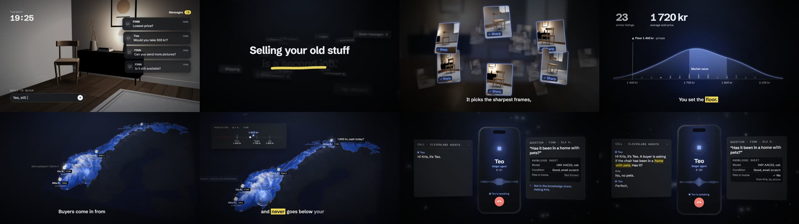

# Selger: launch video

The launch and stage video for **Selger**, an AI agent that sells second-hand items for you: you film the item, and it picks the best frames, identifies the product, prices it from comparable listings, posts it to FINN, eBay and Tise, answers buyers, negotiates within a floor you set, and calls you by phone when a buyer asks something it doesn't know.

Selger was built by our team at a hackathon in San Francisco (October 2026). The agent itself lives in a separate repository. This repo is the video, which I made: it was the hackathon submission video and opened our live stage demo.



## What I did

- Script, storyboard and scene design (`docs/specs/2026-10-04-selger-launch-video.md`)
- 3D scenes and motion graphics in code, including an interactive-looking map of Norway for the negotiation scene and recreated UI cards from the product's design system
- Narration, the agent's phone call, music and sound effects generated with ElevenLabs, with word-level timestamps driving the captions
- A stage cut that combines the video with screen recordings from the live demo

## How it works

- **Remotion** renders React components frame by frame into an MP4.
- **React Three Fiber / three.js** draw the 3D scenes.
- **ElevenLabs** generates voice-over (with timestamps), music and sound effects from scripts in `scripts/`.
- `src/timing.ts` holds the timeline; `src/script.ts` holds every spoken line.

## Running it

```console
npm i
npm run dev                         # Remotion Studio preview
npx remotion render SelgerVideo     # render the launch video
npx remotion render Stage           # render the stage cut
```

The generated audio is committed, so rendering does not need an API key. To regenerate audio, put `ELEVENLABS_API_KEY` in `.env` and run the scripts in `scripts/`.

## Stack

TypeScript, React, Remotion 4, React Three Fiber, three.js, ElevenLabs API.
